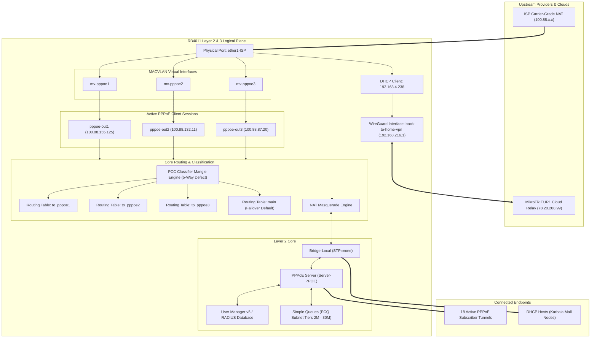
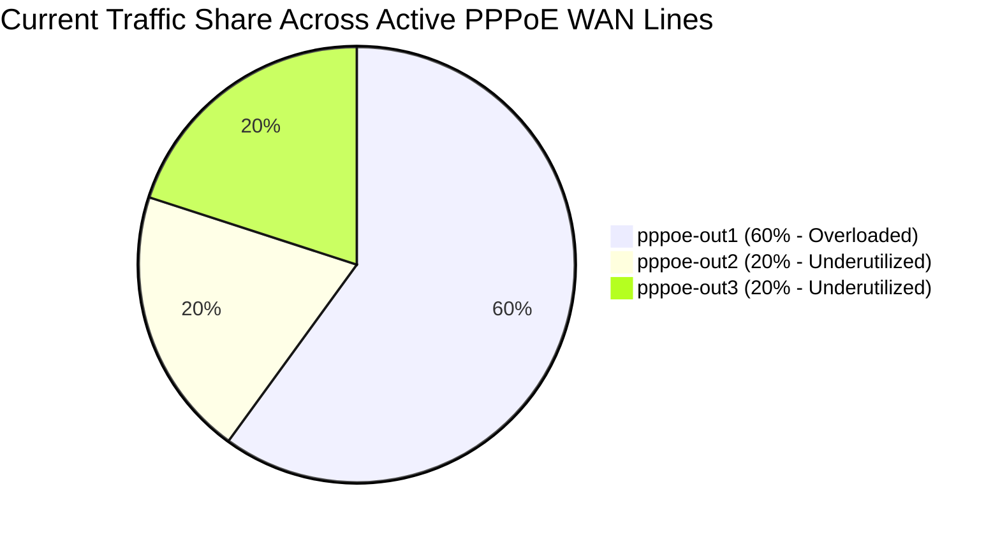

# 12 — NETWORK TOPOLOGY & TRAFFIC-FLOW DIAGRAMS
**Device:** MikroTik RB4011iGS+  
**Audit Discipline:** Network Architecture, Physical & Logical Topology Mapping  
**Audit Timestamp:** 2026-11-15T18:09:53  
**Status:** FULLY INSPECTED & AUDITED

---

## 1. Physical Hardware & Link Topology

```mermaid
flowchart TD
    subgraph WAN_Side["WAN & Upstream Ingress"]
        ISP_MODEM["Upstream ISP Modem / ONT<br/>LAN: 192.168.4.1/24"]
        TOWER_NET["Tower / IXP Network<br/>Gateway: 10.235.51.1"]
    end

    subgraph RB4011["MikroTik RB4011iGS+ (Identity: Home)"]
        direction TB
        subgraph Ports_Switch1["Switch 1 (Realtek RTL8367)"]
            E1["ether1-ISP (1 Gbps)"]
            E2["ether2 (1 Gbps)"]
            E3["ether3 (1 Gbps)"]
            E4["ether4 (1 Gbps)"]
            E5["ether5 (1 Gbps)"]
        end

        subgraph Ports_Switch2["Switch 2 (Realtek RTL8367)"]
            E6["ether6 (1 Gbps)"]
            E7["ether7 (1 Gbps)"]
            E8["ether8 (No Link)"]
            E9["ether9 (1 Gbps)"]
            E10["ether10 (No Link)"]
        end

        SFP["sfp-sfpplus1 (10G SFP+ - Disconnected)"]
        CPU["Annapurna AL21400 4-Core ARM CPU"]
    end

    subgraph LAN_Side["Distribution & Subscriber Nodes"]
        SW_CORE["Access Switch / APs (10.112.152.0/24)"]
        TOWER_RADIO["Wireless Links (10.191.250.0/24)"]
        RB3011["MikroTik RB3011 Node (Karbala Mall 3)"]
        LAN_CLIENTS["Local LAN Nodes (192.168.1.0/24 & 192.168.0.0/24)"]
        MGMT_PC["Admin Workstation (192.168.4.43 / 10.10.10.10)"]
    end

    ISP_MODEM === E1
    TOWER_NET === E2
    E3 === SW_CORE
    E4 === TOWER_RADIO
    E5 === RB3011
    E7 === LAN_CLIENTS
    E9 === MGMT_PC

    Ports_Switch1 -->|"2.5 Gbps SGMII"| CPU
    Ports_Switch2 -->|"2.5 Gbps SGMII"| CPU
    SFP -.->|"Direct 10G MAC"| CPU
```

---

## 2. Logical Architecture & Subsystem Diagram

---

## 3. End-to-End Traffic-Flow Diagram

The diagram below charts the exact transit lifecycle of subscriber data packets from client generation to Internet transit:

---

## 4. Multi-WAN Ingress/Egress Asymmetry Diagram

Visual demonstration of the current traffic distribution imbalance caused by [CRIT-03]:

- **Line 1 (`pppoe-out1`):** Absorbs PCC Hash Remainder 0 (20%) + Unmarked Hash Remainders 3 & 4 (40%) = **60% Aggregate Traffic**.
- **Line 2 (`pppoe-out2`):** Absorbs PCC Hash Remainder 1 = **20% Aggregate Traffic**.
- **Line 3 (`pppoe-out3`):** Absorbs PCC Hash Remainder 2 = **20% Aggregate Traffic**.
